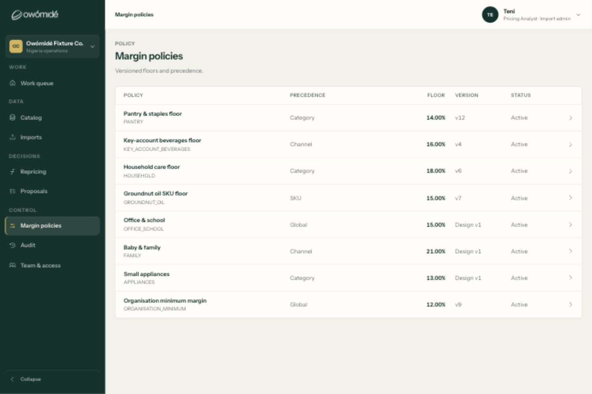
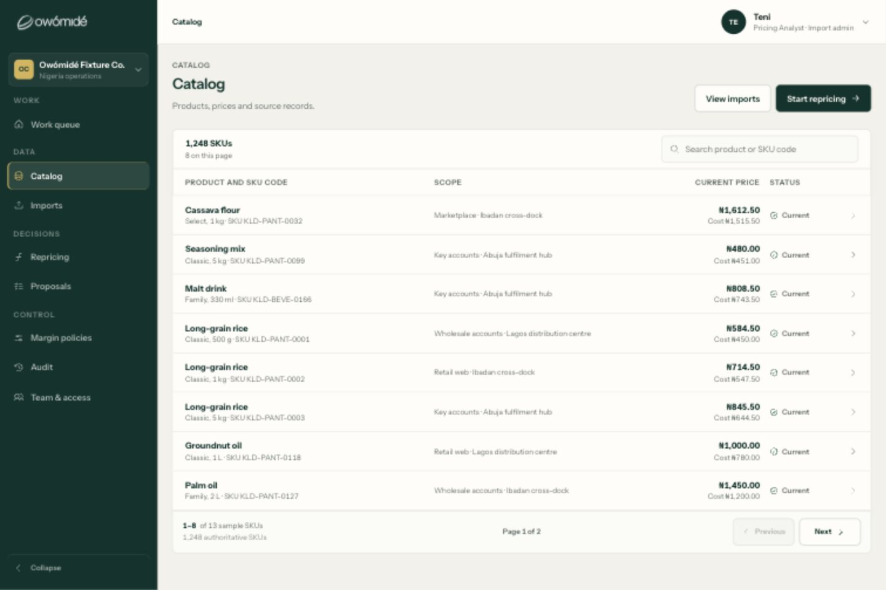
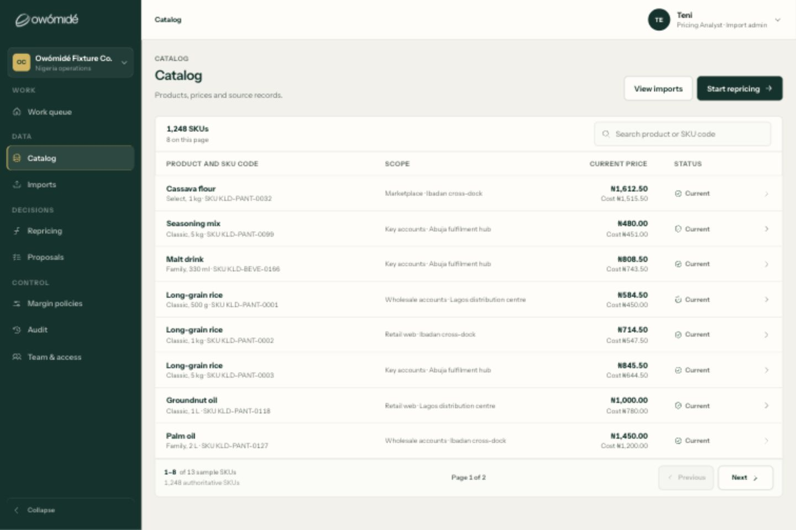

# Column spacing correction — 12 September 2026

## What the earlier pass missed

The earlier checks confirmed that headings and values shared column edges. They did not adequately check the visible distance between neighbouring fields. Alignment alone did not make these tables well spaced: Policy Floor crowded Version, and Catalog price crowded Status. The earlier claim that the table-formatting defects were closed was too broad.

This focused design audit used fresh local browser captures of the two tables before correcting their existing CSS. It did not redesign the app, change pricing or permissions, or push/deploy anything.

## 1. Margin policies — corrected

**Before:** Precedence absorbed surplus width despite containing short labels. Right-aligned Floor values had only a 24px gap before left-aligned versions.

**Change:** cap the Precedence track at 160px; retain a larger flexible identity column; let financial and metadata tracks share the remaining space with content-appropriate minima. Add a desktop-only inset to both Version heading and values. Columns intentionally remain unequal.

**Rendered check:** at 1440px, Precedence decreased from 253.6px to 160px. The actual text gap from every visible Floor value to Version is 48px. The same gap and capped Precedence were verified at 1920px. Header/body tracks still match and rows do not overflow. At 390px, the desktop inset is absent; all eight rows have matching client/scroll widths of 364px.

Before:

After:

## 2. Catalog — corrected

**Before:** the flexible price track ended only 16px before Status, making two separate fields look joined.

**Change:** rebalance product, scope, price and status tracks; give Status its own flexible allowance and a 24px leading inset, paired with its heading. Together with the 24px inter-column gap this provides a clear 48px boundary after price. Product identity and scope retain the largest widths.

**Rendered check:** at 1366px and 1101px, price-to-status-icon gaps measure 48px for Current rows; the attention badges start after the same reserved boundary (their icons have another 10px internal inset). Both sample pages, including Supplier hold and Price missing, retain their content. Header/body tracks match and document/row widths show no horizontal overflow. At 390px, status insets return to zero and the five second-page rows fit at 364px.

Before:

After:

## Verification and limits

- **288 tests passed:** 150 BDD, 130 data, 8 hosting. Production build passed.
- Four new source contracts protect content-weighted tracks, capped Precedence, the paired financial-to-text gutter, and desktop-only inset behaviour. Browser measurements—not these source guards—substantiate the visible gaps.
- Mobile evidence: [Policy](column-spacing-2026-09-12/08-policy-mobile.png), [Catalog](column-spacing-2026-09-12/06-catalog-mobile.png).
- Existing keyboard behaviour and labels remain covered by BDD. This is not a full accessibility certification, an all-screen audit, or a test of arbitrary production-length content. This turn did not exercise a docked Catalog inspector visually.
- The two main before/after pairs use the same 1440×960 viewport. Temporary viewport overrides were reset after verification. Intermediate capture attempts are not acceptance evidence; only the images linked here are used in this report.
