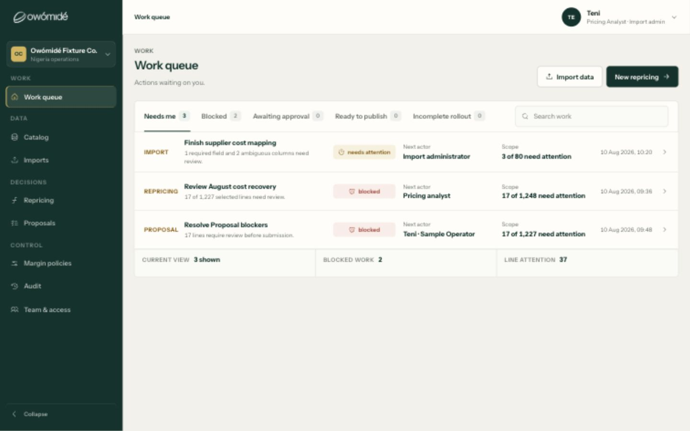
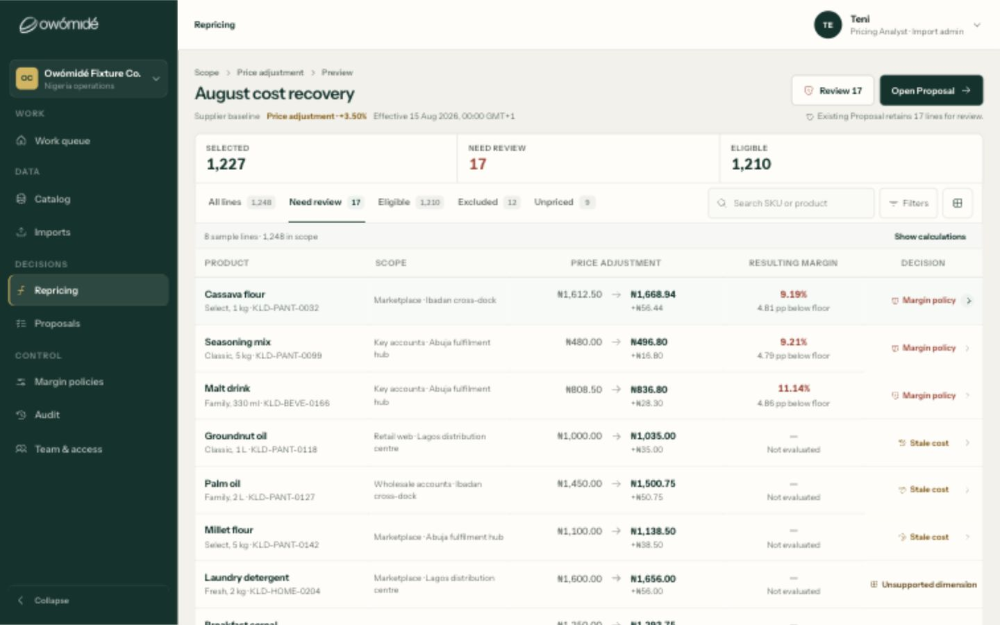
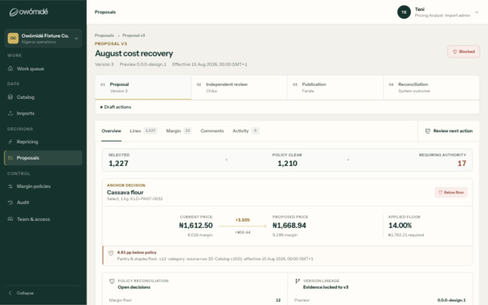

# Journey and design confidence — 12 September 2026

## Verdict

Connected sample journeys: yes. Complete real-company onboarding and live operation: no. Consistently premium, low-effort UX: not yet established, with concrete remaining weaknesses below. Previous checks caught individual regressions but were not a complete state-by-state design acceptance pass. The user did not need a better prompt.

This review uses fresh local-browser captures of Work queue → Repricing → Proposal at 1440 × 900, including opening the proposal's next-action panel, plus a separate read-only source check. It does not re-execute every role, import, approval or publication journey, and it does not verify the hosted Cloudflare build. Screenshots support hierarchy and content observations, not pixel-level contrast certification.

## Current visual walkthrough

### 1. Work queue — connected, but duplicated effort signals

Good: action-led titles, explicit next actors, and working navigation into the review. Remaining issue: the same 17-line concern appears in repricing and proposal tasks. The footer's “Line attention 37” needs to explain whether it counts work-item occurrences or unique lines. Otherwise a user can mistake repeated work for additional problems. The role wording also varies between “Pricing analyst”, “Import administrator” and “Teni · Sample Operator”. The queue should communicate one clear next task and owner, not require reconciliation of labels and counts.

Accessibility/readability risk: secondary descriptions and dates carry important information at a lower visual prominence. Actual contrast and screen-reader comprehension need separate testing; they are not certified here.

### 2. Repricing preview — substantially calmer, still repetitive

Good: current/proposed prices and resulting margin now lead; calculations are available on demand; fewer coloured surfaces compete with the numbers. Queue navigation reaches this review correctly.

Remaining issue: “17” appears in the Review action, explanatory sentence, summary metric and selected tab. Several layers say the same thing before the first row. The most useful summary would distinguish issues the analyst can correct from exceptions needing another person's decision. Keep monetary consequence and the reason a line cannot proceed visible; move repetitive counts and provenance into supporting detail. “Unsupported dimension” also needs a plain-language explanation and correction path when inspected.

Accessibility/readability risk: neutral styling is an improvement only if the secondary text remains readable. Small icon controls need verified accessible names and focus states across widths; this screenshot is not a full interaction/accessibility pass.

### 3. Proposal — linked, but the next step is under-emphasised

Good: preview opens the existing Proposal, the price consequence is explicit, and independent review/publication remain visibly separate stages.

Remaining issue: the overview repeats version information in its breadcrumb, eyebrow, metadata and journey, then prioritises an “Anchor decision”. The user has to open “Review next action” to get the useful explanation: 12 margin exceptions can be reviewed, while source and scope issues need correction in Preview. That explanation and a direct next action should be prominent by default. Optional source/version evidence can remain inspectable without dominating the working view. “Anchor decision”, “Requiring authority” and “Version lineage” are also more abstract than the task demands.

Accessibility/readability risk: the next step is discoverable through a named control, but its collapsed default adds effort for keyboard, screen-reader and first-time users alike. Screen-reader behaviour was not audited in this pass.

## Source-verified journey boundary

| Journey | Implemented sample behaviour | Remaining boundary |
| --- | --- | --- |
| Sign-in and workspace | Sample sign-in/out and capability-aware navigation | Sign-in is in-memory; no actual tenant provisioning, invitations or live authentication |
| Import → Catalog | Upload/mapping/validation/commit/reconciled-result screens | Result explicitly says `catalogWriteAuthoritative: false`, `fixture-memory-only`, and no resulting Catalog reference |
| Scope → adjustment → Preview | Versioned prepared scenario | FX-004 prepared criteria and three complete outcomes: +3.50%, +4.25%, +NGN 25.00; not arbitrary company repricing |
| Analyst → Manager | Company setting can deny Analyst submission; explicit manager handoff preserves author | Fixture-memory permissions and ownership, not server enforcement |
| Contributor → triage | Separate request, own receipt/status, manager triage, internal-note redaction | No connected request-to-pricing-work creation journey; no Proposal access is intended |
| Proposal review | Assigned review, return, title revision, resubmit and approval | A return that requires changed pricing/scope has no guided replacement-Preview route; title revision is not sufficient |
| Commercial / Executive | Named sample identities use the shared decision capability | Single assigned stage; not proof of configured company approval chains or production role mapping |
| Publication / reconciliation | Separate executor and sample operation/result states | Real connector acknowledgements, durable operation recovery and company destinations remain live integration work |

The live repository rejects non-fixture mode with `LIVE_ADAPTER_NOT_RELEASED`. This is an intentional boundary, not a deploy-ready live workflow.

Source anchors (paths relative to `apps/workspace`):

- `src/data/workspaceRepositories.js:17` — live gate.
- `src/OperationalWorkspace.jsx:164` — sample login; `:771` / `:882` — prepared scope/rule UI.
- `src/data/fixtureOperationalRepositories.js:921` — non-authoritative Catalog result.
- `src/data/fixtureWorkspaceRepositories.js:965` / `:1200` — prepared scenario constraints.
- `src/data/fixtureWorkspaceRepositories.js:169` / `:2047` — Analyst policy and manager handoff.
- `src/data/fixtureCompanyRequests.js:31` / `:159` — separate, scoped request access and triage.
- `src/RoleWorkspace.jsx:317` and `src/data/fixtureWorkspaceRepositories.js:2072` — returned-draft title-only revision boundary.
- `src/data/fixtureWorkspaceRepositories.js:111` / `:2337` — single assigned approval stage.
- `src/RoleWorkspace.jsx:217` — sample company access, production role mapping unverified.

## What “premium” must mean here

The user should immediately understand: what changed, what prevents progress, what they can do now, and who acts next. Shorter copy helps only when it removes repetition rather than essential pricing risk. Predictable controls, content-aware column widths, consistent spacing, reachable detail and recoverable errors are baseline quality, not optional embellishments.

The next acceptance pass should use a screen × state × role × viewport checklist, not a page checklist alone. Include long content, open controls, empty/error states, interrupted work, returned proposals, permission-denied paths, nested-scroll boundaries and keyboard focus. BDD verifies behaviour; visual inspection verifies layout; first-time-user task testing verifies comprehension. None substitutes for the others.

Priority: (1) complete the returned-proposal pricing revision loop; (2) simplify the next-action hierarchy and repeated copy/counts; (3) standardise the remaining control/layout states; (4) run the complete role-based desktop/mobile acceptance matrix; (5) integrate and verify real-company onboarding against the backend gates. No investor-reaction or full-product quality guarantee is justified by this focused review.

## Separate fix verification

The immediately preceding inspector scroll fix is now verified locally: 330 automated tests pass (148 data, 174 BDD, 8 hosting) and the production build passes. Native browser checks cover All lines / Need review / Eligible, short desktop, mobile document flow and wide dock. See `INSPECTOR_SCROLL_CONTAINMENT_2026-09-12.md` for the exact scope. These totals are regression evidence, not a premium-design sign-off. Nothing was pushed or deployed during this review.

## Implementation follow-up

The subsequent local implementation closes the prepared returned-Proposal pricing revision gap and improves queue counts, visible next steps, repeated repricing summaries and remaining select controls. The historical findings above describe the pre-fix state. See `JOURNEY_FIXES_2026-09-12.md` for the delivered changes, fresh desktop/mobile screenshots and the passing 352-check regression/build result. Live onboarding and arbitrary company repricing remain outside the fixture's capability; the original production-readiness caveat is unchanged.
