# Workspace table consistency audit

Follow-up: the identified formatting defects were subsequently implemented and verified. See [table fixes and fresh evidence](TABLE_FIXES_2026-09-12.md). This audit remains the unchanged before-state record.

Date: 12 September 2026

Branch: `polish/workspace-premium-desk`

Preview: local workspace on port 4174

Scope: read-only visual review, computed layout measurements and source cross-check. No application source was changed, committed, pushed or deployed during this audit.

## Verdict

**Improved, but not uniformly premium yet.** The shared font family and restrained palette give the workspace a common foundation. Catalog is the strongest baseline for header alignment, readable identities and prices. Repricing is calmer in its default consequence view and its inspector fits at the tested desktop size. However, Proposal content is genuinely clipped at a common laptop width, text roles vary across directories, and two header/body alignment defects remain.

Premium here means fast, dependable comparison: clear hierarchy, aligned values, enough space for real data, predictable interactions and no missing information when the available width changes. It does not mean adding ornament or making every row equally tall.

## Coverage and method

Fresh screenshots were captured in the in-app browser, saved locally, reopened and inspected. Measurements below are rendered CSS pixels, not estimates from scaled screenshots.

- Desktop: 1440 × 960.
- Laptop boundary: 1366 × 900, expanded navigation.
- Mobile: 390 × 844.
- Session: Teni, sample Pricing Analyst / import preparation access.
- Interactions: navigation, opening/closing the Repricing inspector and opening an existing import's mapping stage. No prices, mappings, policies, proposals or permissions were submitted or changed.
- Source inventory was independently cross-checked by a read-only subagent.

## Findings, in priority order

### P1 — Proposal columns are clipped at 1366px

Evidence: capture 12. The surface ends at x=1342; the final cell extends to x=1393, and the Updated cell to x=1360. The enclosing surface uses hidden overflow, while the list itself has visible overflow. Its measured scroll width is 1112px against 1060px of available list width.

This hides the disclosure column and crowds/crops the date without offering a local scrollbar. Document width remains 1366px, so a page-level overflow assertion alone would incorrectly pass.

Cause: the Proposal grid's minimum tracks require more space than the expanded-sidebar layout provides. The scroll fallback in `src/platform.css` starts only at a viewport width of 1279px, missing this intermediate state.

Fix direction: base the fallback on the table container's available width. Either provide intentional local scrolling or switch to a defined reduced-column/card layout; never silently clip required values. Test both expanded and collapsed navigation, and check each cell against its actual clipping ancestors.

### P2 — Shared font family, inconsistent text hierarchy

Evidence: captures 02, 03, 04, 08, 11, 14 and 15; corroborated by computed styles and source.

| Surface | Primary text | Supporting text | Consequence |
| --- | --- | --- | --- |
| Catalog desktop | 14px / 20px | 14px / 20px | Weight and colour separate identity from metadata; readable baseline |
| Proposal directory | 12px / 18px | 12px / 18px | Small text sits inside a roughly 96px row; hierarchy feels flat |
| Margin policies | 12px / 18px | 12px / 18px | Primary names and supporting codes receive almost equal emphasis |
| Repricing desktop identity | 12.5px / 16px | 13px / 16px | Supporting SKU/variant text is larger than the product name |
| Repricing mobile identity | 12px | 12px | Visibly smaller than Catalog's mobile record identity |

Fix direction: define and reuse text roles rather than inheriting route-specific rules. A sensible starting specification is primary 14/20, supporting 12/18 and header 12/16, with financial values using tabular numerals. Validate that specification visually before applying it across every surface. Compact mode should be an explicit variant, not an accidental smaller font on one route.

### P2 — Header/body alignment still drifts

Evidence: captures 04 and 06.

1. Import mapping header has 22px horizontal padding; body rows have 24px. The first header starts at x=303, body content at x=305. Because the grid calculates tracks inside those differently sized content areas, subsequent column starts also drift.
2. The Margin-policy Floor heading is left-aligned while its value is right-aligned inside the corresponding track. This breaks the vertical scan established by the correctly paired Catalog price heading and values.

Fix direction: one track definition and one inline inset shared by the header and all rows; one alignment rule shared by each header/cell pair. Numeric alignment should not be inferred separately in each component.

### P2 — Proposal filters lose their continuation cue

Evidence: captures 03, 12 and 15. Later Proposal filters disappear beyond the visible strip; the last label is clipped on desktop. There is no equivalent of the Repricing strip's visible overflow cue. The controls are ordinary buttons without the tab semantics used in the stronger shared tab pattern.

Fix direction: reuse one overflow-aware filter/tab strip with clear continuation, active-item visibility and predictable keyboard behaviour. Do not squeeze labels and counts to make them fit.

### P2 — Density needs deliberate variants, not one global row height

Evidence: captures 01–08 and 11–17. Current observed desktop rows range from Catalog's 64px and Repricing's 68px to Imports' 84px, Mapping's 93px and Proposals' 96px. Taller rows are justified when they carry a workflow owner or mapping evidence, but not when small text simply floats in spare space.

The Work queue also loses its trailing gutter at 1366px: the disclosure cell reaches the surface's right edge (capture 13). Mobile Repricing and Mapping repeat labels and internal rules more heavily than Catalog; mobile Proposal identity is noticeably smaller. These are cross-surface rhythm differences, not all overflow bugs.

Fix direction: define compact data rows and richer workflow rows, with content-driven expansion. Use shared vertical text gaps and inline padding, consistent trailing action gutters and one mobile record anatomy. Keep secondary evidence available in details rather than repeating every label in every row.

## Acceptance standard for the implementation

The following is a proposed specification, **not work implemented by this audit**:

- **Hierarchy:** shared primary, supporting, header and numeric roles. Product/proposal identity should not be smaller than its metadata.
- **Alignment:** shared header/row tracks and padding; text left-aligned, standalone numerical values and their headings right-aligned. Price-comparison composites may use a documented internal layout.
- **Density:** named compact-data and workflow variants, with minimum heights rather than fixed heights that cut off wrapped content.
- **Spacing:** one desktop inline inset (20px is already working in Catalog) and one mobile inset; consistent text gaps and trailing action space.
- **Colour:** use one restrained state cue per decision; reserve stronger treatment for actionable exceptions. Avoid repeating the same warning in several coloured forms within one row.
- **Overflow:** no hidden required values; intentional horizontal scroll or card reflow based on available container width. Long names, currencies, timestamps and translated labels must remain usable.
- **Interaction:** the same row opening, focus, dismissal, tabs and pagination behaviour across comparable surfaces. An inspector should not squeeze an otherwise valid table into unreadable columns.

### Behaviour-driven checks to add with the fixes

1. Given expanded navigation at 1366px, when Proposals renders, then all columns remain visible or reachable by explicit local scrolling; neither date nor disclosure is clipped.
2. Given any table width and density, when a header and row render, then their matching column tracks and padding align, and numeric headings share their values' alignment.
3. Given long product/SKU/scope text or a large formatted amount, when a row renders, then it cannot overlap the adjacent column; any truncated identity is recoverable through an accessible detail view.
4. Given a mobile view, when a record reflows, then its identity, status, price and next action retain a consistent hierarchy without horizontal document overflow.
5. Given an overflowing filter strip, when a later filter is selected with keyboard or touch, then it is visibly selected and brought into view.
6. Given an open inspector, when it closes, then the prior row and keyboard focus are restored without losing the list's filter or page state.

Geometry checks must inspect individual cells and clipping containers, not only `document.scrollWidth`. Behaviour tests must be accompanied by screenshot review; neither is a substitute for the other.

## Step-by-step visual record

### 01 — Work queue, desktop: mostly healthy

Clear next-action hierarchy and usable rich rows. Some actor text truncates; narrower-width action gutter needs attention (step 13). This is a workflow list, so it should not be forced into Catalog's shorter data-row height.

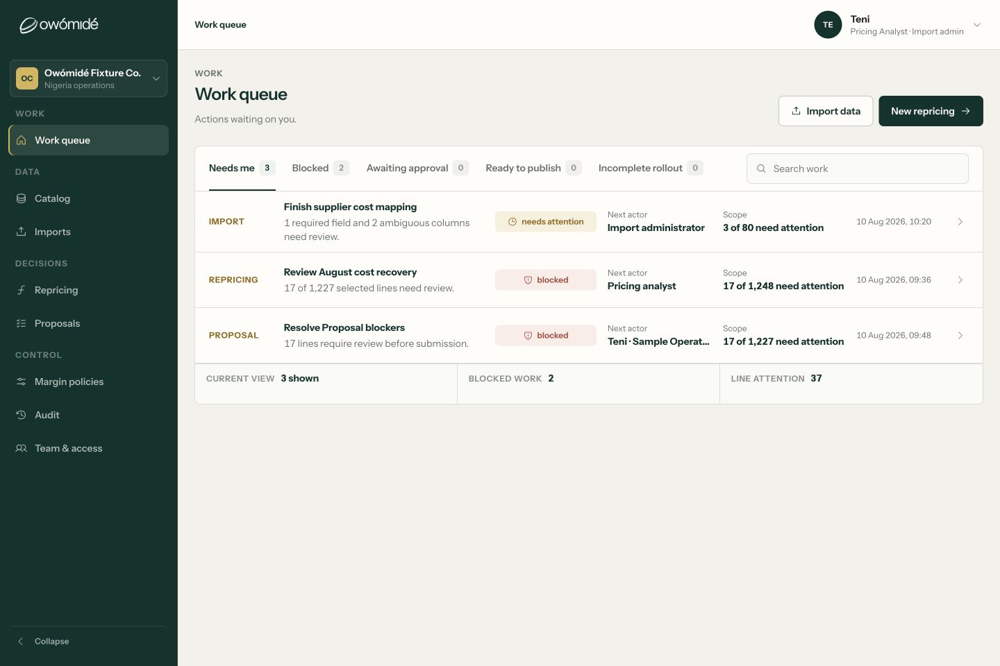

### 02 — Catalog, desktop: strongest baseline

64px rows, matching 20px header/body insets and matching tracks. Price heading and amounts are right-aligned. Good balance of identity, scope, amount and status.

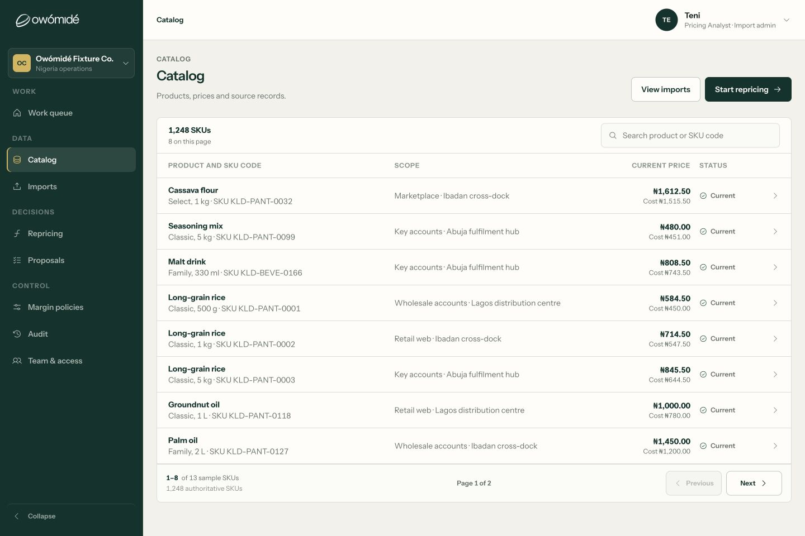

### 03 — Proposal directory, desktop: needs refinement

Columns fit at 1440px, but 12px primary and supporting text flatten the hierarchy. Later filter labels are partially hidden. This acceptable-width screenshot must not mask the 1366px failure.

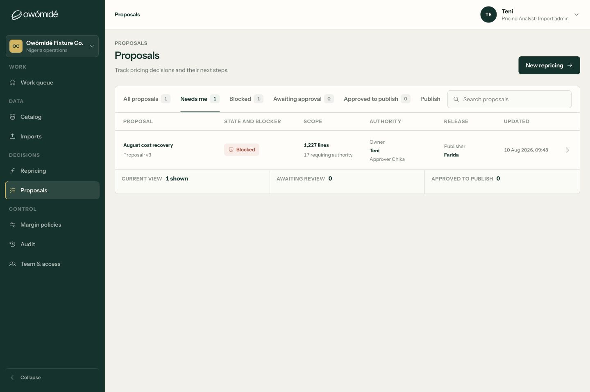

### 04 — Margin policies, desktop: alignment and hierarchy gap

Readable but unnecessarily small primary names. Floor heading and values do not share alignment. Status treatment is appropriately restrained.

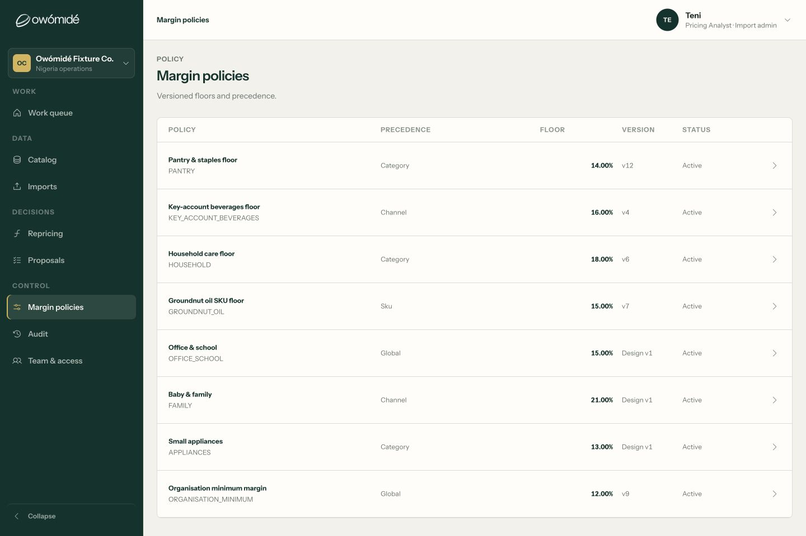

### 05 — Import ledger, desktop: mostly healthy

Matching header/body columns, clear 14px identity and 12px supporting evidence. Richer row height is justified by progress and accounting content.

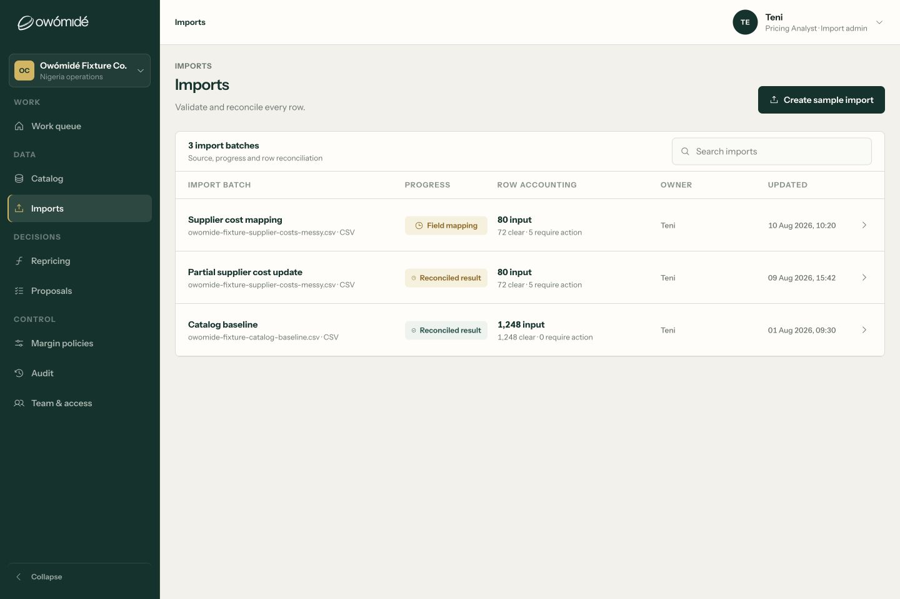

### 06 — Field mapping, desktop: measured inset defect

The 22px header inset differs from the 24px row inset. Exception rows carry several simultaneous colour cues. Capture is focused on the mapping table at the existing stage's scroll position, not a full-page composition review.

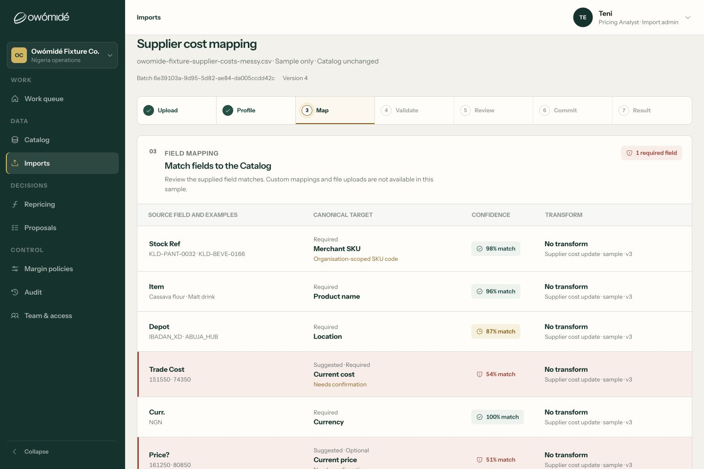

### 07 — Audit ledger, desktop: healthy event-list pattern

14px event labels and 12px evidence give a useful hierarchy. Its event-list format is justified; adding table headers simply for uniformity would not improve it.

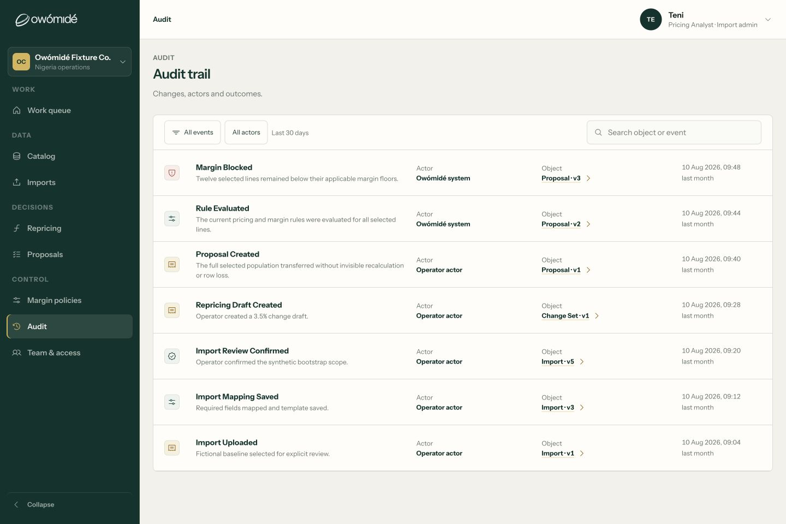

### 08 — Repricing, desktop: calmer, typography needs consolidation

The default consequence view reduces repeated calculations and visual noise. Product identity is nevertheless smaller than the supporting variant/SKU line.

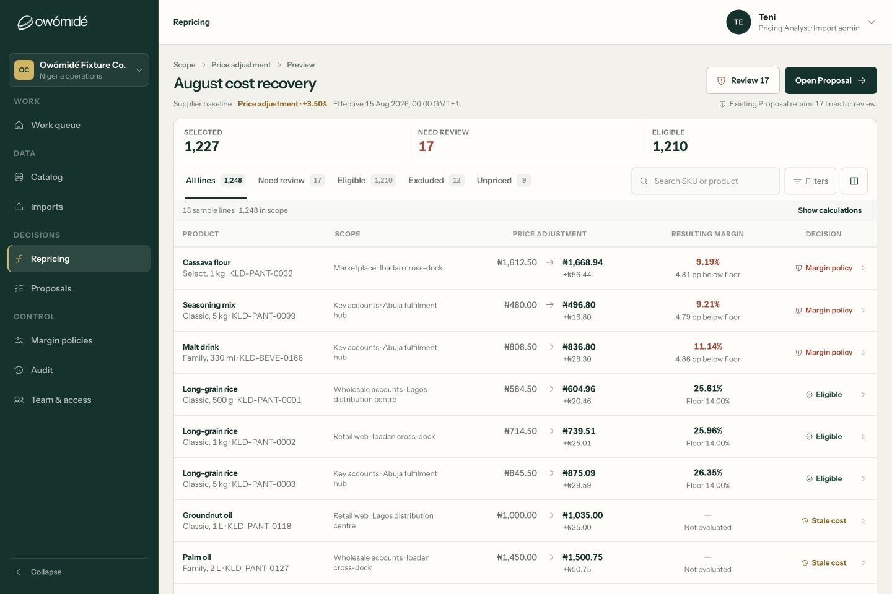

### 09 — Repricing inspector, desktop: healthy at tested size

The price comparison fits and the inspector opens from the row and closes. The table behind retains its geometry; covered columns are intentional overlay behaviour, not squeezed columns. A full keyboard focus-restoration audit was not performed.

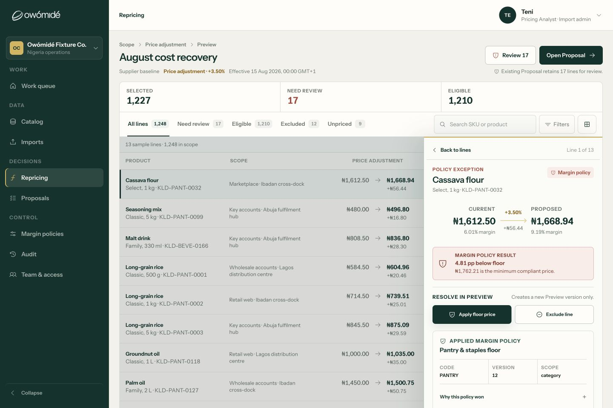

### 10 — Repricing, mobile overview: fits

Summary, filters, search and first card fit in 390px. Overflowing tabs have a visible continuation treatment. This is stronger than the Proposal filter strip.

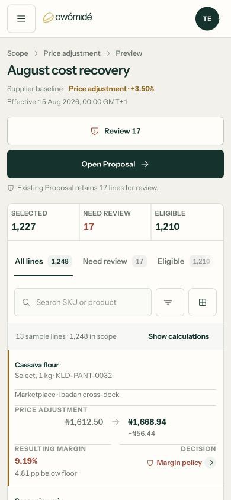

### 11 — Repricing, mobile rows: no price overlap; dense hierarchy

Document width is 390px, with no price overlap in the captured rows. Repeated labels and rules create more fragmentation than Catalog's record cards, and the 12px identity is small.

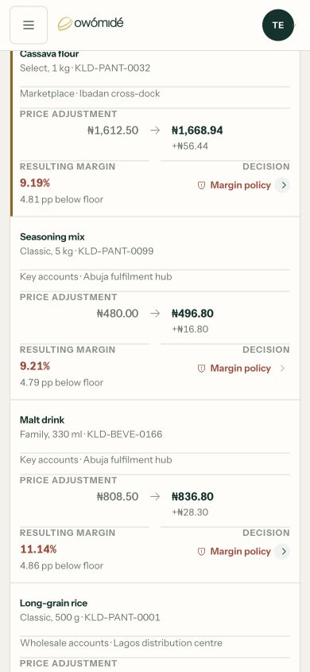

### 12 — Proposal directory, laptop: failed containment

At 1366px, the surface ends at x=1342 but the final cell extends to x=1393. The date and disclosure no longer fit, without a usable scroll fallback. This is the highest-priority confirmed defect.

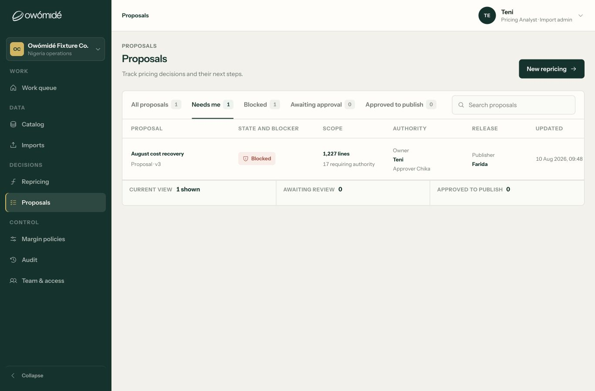

### 13 — Work queue, laptop: trailing gutter collapses

The disclosure cell reaches the surface edge. Some next-actor text truncates. This capture does not establish that Work has the same missing-column defect as Proposals; the finding here is the lost gutter and reduced readability.

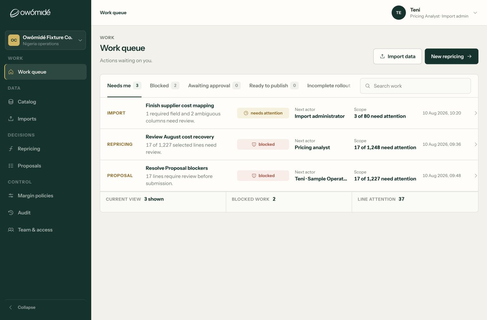

### 14 — Catalog, mobile: healthy baseline

The identity and scope wrap naturally, with price and status separated below. Document width is 390px. Primary identity is clearer than the smaller mobile Repricing/Proposal titles.

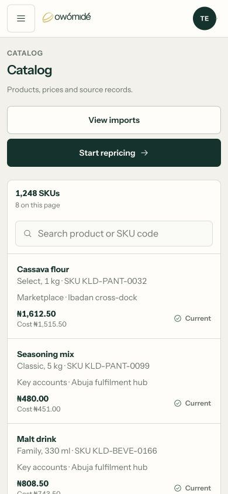

### 15 — Proposal directory, mobile: fits, but too flat

No document overflow at 390px. Primary identity remains 12px, multiple divider rows fragment a single decision, and hidden later filters have no clear continuation cue. The publisher group has a different visual baseline from the owner group.

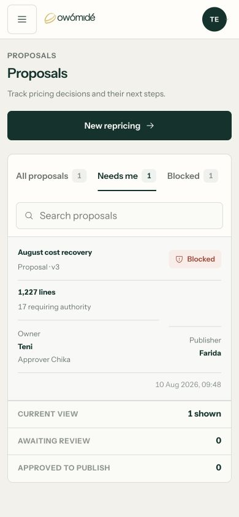

### 16 — Team & access, desktop: coherent simple list

The two-column name/role list is appropriate and readable; it does not need to become a financial table. The sample-only and disabled policy state are explicit. This is not verification of live membership management or backend enforcement.

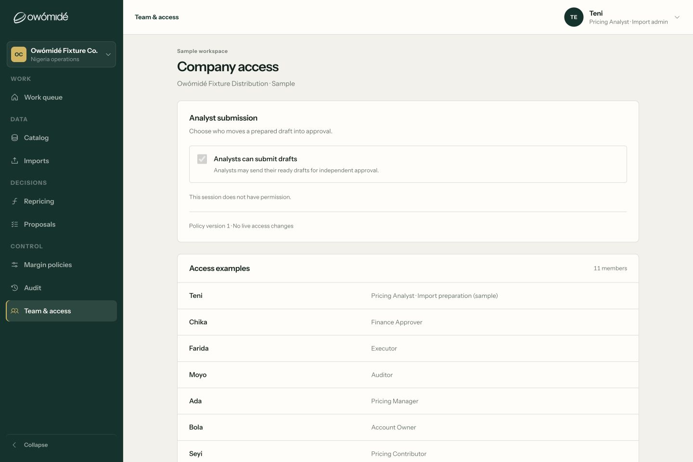

### 17 — Field mapping, mobile: fits, but verbose

The first mapping reflows to a readable card, with no document overflow at 390px. Four repeated field labels plus transform provenance make it tall; progressive disclosure could reduce scanning effort. No mapping was confirmed or validation started.

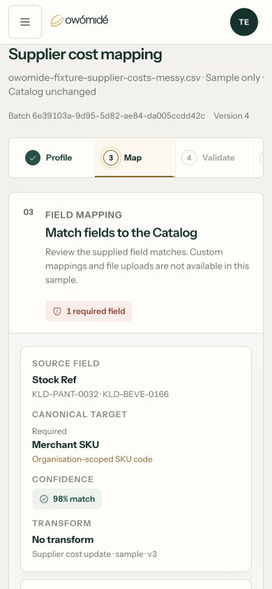

## Accessibility and evidence limits

- The clipped Proposal content is a confirmed usability defect; a screenshot alone cannot determine its full screen-reader impact.
- Proposal filters are regular buttons in the inspected DOM; they do not expose the same tab/selection model as the stronger tab pattern. Full keyboard navigation, focus restoration, zoom, contrast ratios and screen-reader announcements still need dedicated checks.
- Repricing uses a native table; several directories use header-like grids and button rows. Source inspection suggests a need to review programmatic column associations. This audit does not certify WCAG compliance.
- Requests' populated list and all role-specific empty/error/loading states were not visually exercised. The request-list structure was source-reviewed only.
- No claim is made about every record, every breakpoint, every import stage, the landing page, backend readiness or live company onboarding. This audit is specifically the shared table/list formatting pass.
- Large/negative/multi-currency values, arbitrary long customer data and zoomed text were not newly exercised. Existing BDD/build results from earlier work were not rerun or represented as fresh evidence.

## Source anchors for the next implementation

- `src/platform.css:535` — Proposal grid minimum tracks.
- `src/platform.css:545` — Proposal 12px primary/supporting styles.
- `src/platform.css:560` — Policy 12px primary/supporting styles.
- `src/platform.css:619` — viewport-based medium desktop fallback.
- `src/platform.css:366` — Mapping header inset.
- `src/workspace-premium-system.css:456` — Mapping body inset override.
- `src/workspace.css:238` — Repricing identity/supporting size inversion.
- `src/catalog-record.css:123` — matching Catalog header/row tracks and insets.
- `src/OperationalWorkspace.jsx:926` — Proposal filter controls and directory structure.

Recommended implementation order: containment first, shared text/alignment primitives second, mobile record/filter consistency third; then fresh visual and behavioural regression checks. Preserve the distinct jobs of a pricing table, a workflow queue and an audit event list.
