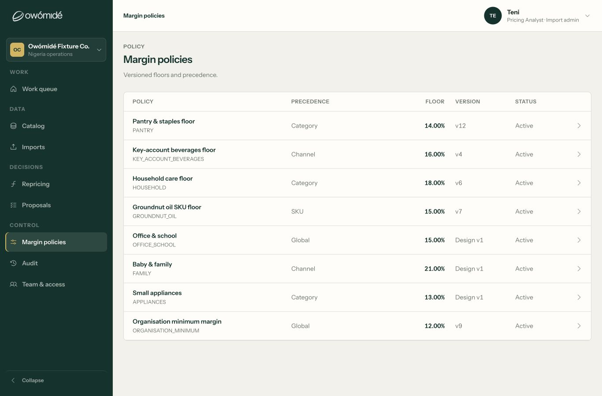
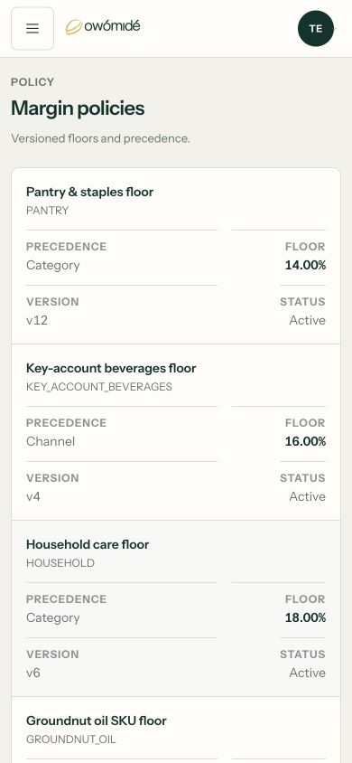
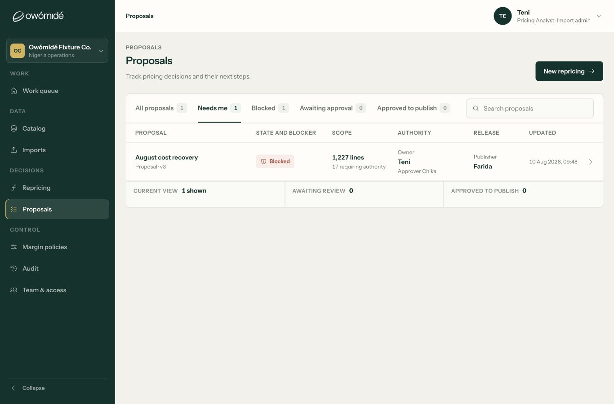
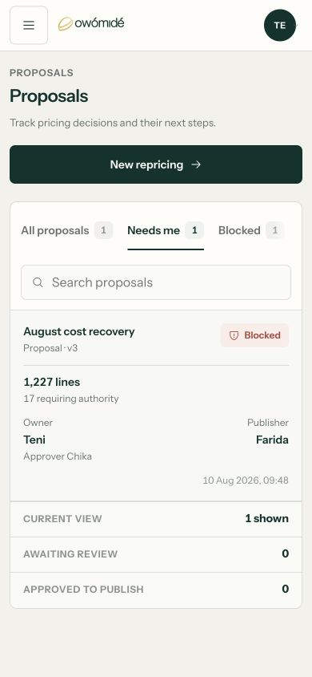

# Workspace table fixes — 12 September 2026

Follow-up to [the table consistency audit](TABLE_CONSISTENCY_AUDIT_2026-09-12.md).

**Subsequent correction:** the user's next review exposed remaining optical spacing defects in Policy and Catalog. [The column-spacing follow-up](COLUMN_SPACING_REVIEW_2026-09-12.md) documents that miss, the corrected allocation and fresh browser evidence. The earlier alignment checks below did not establish sensible inter-column spacing.

## Implemented

- **Margin policies:** Floor heading and percentages now share a right edge; header/body tracks and gaps match. Primary names use the shared 14/20 scale, supporting codes 12/18. Data rows have a 64px minimum. Mobile Precedence/Floor fields start together, with matched labels and divider positions. SKU is correctly capitalised.
- **Proposal directory:** flexible column tracks fit the expanded-sidebar laptop view. The ledger owns horizontal scrolling if available space is narrower than its minimum, instead of letting the enclosing card hide content. Primary/supporting text is separated, rows use the workflow density and mobile owner/publisher groups share a baseline without redundant dividers.
- **Work queue:** restored trailing action space, removed oversized track minima and allowed actor/scope text to wrap. Important identities are no longer ellipsised simply to fit the fixed actor column.
- **Imports and mapping:** Import ledger headers and rows share tracks, insets and overflow containment. Mapping header and rows now both use the same 20px desktop inset. Routine high-confidence matches have quieter styling; informational mapping notes are neutral rather than gold.
- **Catalog and Repricing:** primary identity 14/20, supporting identity 12/18, preserving price calculations and column geometry. Mobile Repricing no longer shrinks identity to 12px. Expanded stale-cost labels wrap within their price endpoint at 320px instead of escaping the cell. Paired mobile margin/decision labels reserve equal space when they wrap.
- **Audit, Requests and team lists:** reused shared primary/supporting text roles; retained appropriate event-list and member-list layouts rather than forcing every surface into an identical table.
- **Shared controls:** Work and Proposals use one overflow-aware tab component with selected-state semantics, roving keyboard focus, Arrow/Home/End navigation, active-tab visibility, resize handling and reduced-motion support. Proposal search is explicitly labelled and retains its state filter.
- **Permission-shaped actions:** Viewer Catalog no longer presents unavailable Import/Repricing actions. Authorised sessions retain them. Existing routing guards and economics restrictions remain unchanged.

These edits update existing rules and introduce shared tokens/component behaviour. They do not introduce a new override stylesheet or change pricing maths, policy precedence, proposal authority or backend contracts. The landing page was not changed. Nothing was committed, pushed or deployed.

## Browser evidence

Fresh checks used the local in-app browser at 1440, 1366, 1024, 390 and 320px, with coverage appropriate to each changed surface. This is not a claim that every surface was exercised at every width.

| Check | Before | Verified after |
| --- | --- | --- |
| Policy Floor, 1366px | Heading/value alignment differed | Both right edges x=1009; identical header/row tracks and 24px gaps |
| Proposal, 1366px | Final cell extended to x=1393 beyond surface x=1342 | Final cell ends x=1322; list client/scroll width both 1060px |
| Work, 1366px | Trailing disclosure reached card edge | Disclosure ends x=1320, surface x=1342; list fits 1060px |
| Import ledger, 1366px | Fixed tracks lacked a safe all-width fallback | Every header/body column start matches; client/scroll width both 1060px |
| Mapping, 1366px | Header 22px inset, rows 24px | Both 20px; all four column starts match exactly |
| Catalog, 1440px | Identity and metadata both 14px | Shared primary14/supporting12; header/row tracks remain identical |
| Repricing calculations, 1440px | Typography inconsistent with Catalog | Primary14/supporting12; no inspected price text escapes its cell |
| Repricing calculations, 320px | Three stale-cost notes escaped the price cell | No inspected price text escapes; all stale-cost notes fit/wrap in their 99px endpoints |
| Mobile policies, 320px | Precedence/Floor dividers staggered | Both cells start at y=254.195px; row client/scroll width both 294px |
| Mobile Proposal tabs | Later filters lacked a clear continuation pattern | End selects/reveals Published; Home returns to All; active tab is within the scroll rail |

At 320px, Catalog, Proposal and Mapping row content and document bounds were checked without horizontal document overflow. Work, Audit and team rows were also checked for containment at 390px. Repricing inspector fit was visually checked at 1024px and 390px; closing it returned focus to the originating product control.

### Policy alignment

### Proposal containment and typography

### Additional captures

- [Work laptop](table-fixes-2026-09-12/03-work-laptop.png), [Work mobile](table-fixes-2026-09-12/04-work-mobile.png).
- [Import ledger](table-fixes-2026-09-12/07-imports-laptop.png), [Mapping laptop](table-fixes-2026-09-12/08-mapping-laptop.png), [Mapping mobile](table-fixes-2026-09-12/09-mapping-mobile.png).
- [Catalog desktop](table-fixes-2026-09-12/10-catalog-desktop.png), [Catalog mobile](table-fixes-2026-09-12/11-catalog-mobile.png).
- [Repricing desktop](table-fixes-2026-09-12/12-repricing-desktop.png), [Expanded calculations](table-fixes-2026-09-12/13-repricing-calculations-desktop.png).
- [Tablet inspector](table-fixes-2026-09-12/14-repricing-inspector-tablet.png), [Mobile inspector](table-fixes-2026-09-12/15-repricing-inspector-mobile.png), [Small-phone stale-cost wrapping](table-fixes-2026-09-12/16-repricing-calculations-small-phone.png).
- [Audit desktop](table-fixes-2026-09-12/17-audit-desktop.png), [Audit mobile](table-fixes-2026-09-12/18-audit-mobile.png), [Team desktop](table-fixes-2026-09-12/19-team-desktop.png).

Captures were made during the verification pass; later minor neutral-colour and mobile-label adjustments do not alter the measured column results above. The policy laptop/mobile captures show the final corrected policy geometry.

## Regression coverage

Final validation after the implementation: **150/150 BDD tests, 126/126 data tests and 8/8 hosting tests passed.** The production Vite build also passed. Browser measurements above complement the automated checks; source-level layout guards are not a substitute for rendered inspection.

- `tests/workspace-table-consistency-bdd.test.jsx`: seven behavioural scenarios covering tab navigation, labelled panels, search/filter retention, exact-version row navigation, Catalog inspector focus and paging preservation, Viewer economics/action restrictions and policy floor/version association.
- `tests/workspace-viewtabs-overflow-bdd.test.jsx`: three scenarios covering active-filter reveal, resize/overflow state and reduced-motion behaviour.
- `tests/data/workspaceTableLayout.contract.test.mjs`: six source-level guards for shared tokens, paired tracks/insets, numeric alignment, safe local overflow and mobile policy alignment. These are structural guards, not browser geometry tests.

## Limits

This closes the identified table-formatting defects, not the separate backend/onboarding programme. Populated Requests were source/behaviour-reviewed rather than visually exercised with new records in the user's persisted sample session. Screen-reader certification, arbitrary production-length/large-value data and every role/loading/error combination are not claimed. Existing project changes were preserved.
