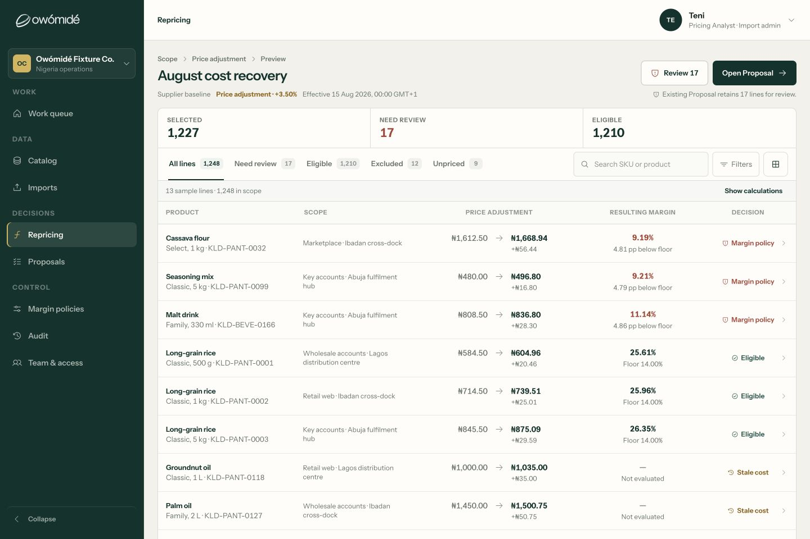
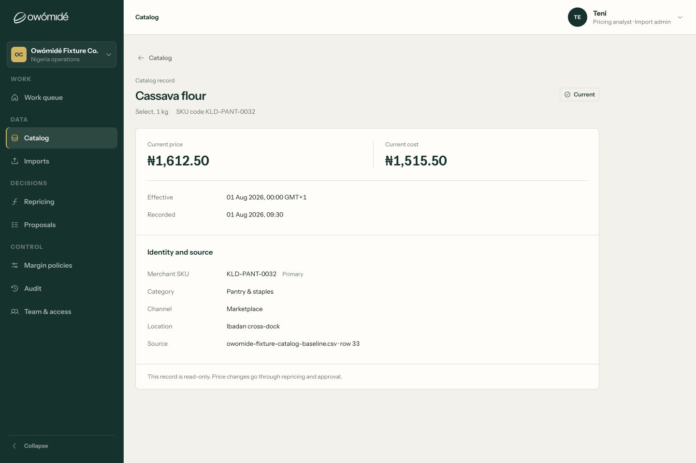

# Workspace design and journey acceptance — 8 September 2026

## Outcome and release boundary

This implementation pass is ready for product review as a **sample-backed frontend**, not for onboarding real companies. It extends the existing `polish/workspace-premium-desk` worktree without committing, pushing, deploying, or replacing the approved marketing design. Other contributors' existing work remains in place.

The design review used the running application, saved screenshots, DOM inspection, and desktop/mobile interactions. The role and recovery checks also exercise the fixture repository contracts and rendered React components. None of that proves live service authorization, persistent company data, or external price delivery.

The live adapter still fails closed with `LIVE_ADAPTER_NOT_RELEASED`. A hosted frontend is not a live backend. Role switching is explicitly a sample-preview facility, not authentication.

## What changed

### A calmer working surface

- Repricing opens with the consequence: current/proposed price, resulting margin, and decision. The fuller arithmetic is available through **Show calculations** rather than repeated at full visual weight on every row.
- Color distinguishes actionable exceptions; ordinary amounts, row identity, and supporting metadata have a quieter hierarchy. Numerical precision is preserved.
- Rows remain actionable; line inspection is dismissible, with a consistent return path. Narrow screens reflow the price/policy content instead of compressing desktop columns.
- The Catalog record is now a compact record sheet. Prices are separated from effective/recorded dates; full SKU/source metadata wraps; the read-only explanation no longer collapses into a vertical column of words.
- Shared typography and spacing foundations, contained icons/checkboxes, scoped Import/Proposal styles, and container-aware amount layouts address the repeated alignment failures.
- Import review and acknowledgement are distinct, comfortably separated blocks. Proposal tabs use a scrollable narrow-screen strip rather than squeezed labels. Optional draft tools stay collapsed unless the workflow needs attention.
- The approved landing page is unchanged. Its login link and workspace logout were exercised in the local browser.

### Role journeys, not just new role names

- **Pricing Analyst:** separate draft preparation and submission; a versioned company setting can disable Analyst submission. Handoff assigns an eligible Manager as the submission owner while retaining the original author.
- **Pricing Manager:** can receive the draft, make permitted title edits, and submit the exact current version. Queue ownership and Needs me reflect the actual next actor, not a matching label.
- **Pricing Contributor:** separate request creation, own-request list and receipt. Manager triage can change status and add an internal note; the Contributor receives status only, with no Proposal, comments, cost-rich Catalog, or internal note access.
- **Reviewers:** Finance, Commercial and Executive sample assignments use the same decision path. Return for changes requires a reason and creates a fresh draft/blocked version; approval/publication is cleared while history and authorship remain. The implementation does not invent a sequential review hierarchy.
- **Viewer:** read-only Proposal directory without New repricing or false Needs me counts. Restricted economics are removed from fixture responses, not merely hidden with CSS. Selling prices remain useful; cost, margin, rules and protected notes are not exposed.
- **Executor / Auditor / Account Owner:** existing responsibilities remain distinct in the sample. The Owner's company-policy authority is an explicit fixture example, not a verified mapping of production legacy roles.
- AI remains deferred. Workspace Admin, Vendor Manager and FDE access were not introduced.

## Journey review and evidence

Screenshots were captured and inspected during this run with the Codex in-app browser. Sizes below are CSS viewport sizes; this is representative coverage, not every screen multiplied by every size and role.

| Step | Journey and health | Current-run evidence |
| --- | --- | --- |
| 1 | Landing → login → Work → logout: working locally; real session lifecycle is a backend gate. | [Login, 1280 × 720](journey-2026-09-08/32-login-from-landing.png), [Work entry](journey-2026-09-08/33-work-from-login.png) |
| 2 | Import → mapping → validation/review → acknowledged commit → unknown outcome → reconciliation: working prepared-sample recovery. Seven-stage creation flow also covered by BDD. | [Mapping](journey-2026-09-08/21-import-mapping.png), [desktop review](journey-2026-09-08/22-import-review-desktop.png), [390px review](journey-2026-09-08/23-import-review-mobile.png), [settled result](journey-2026-09-08/25-import-result-mobile-settled.png) |
| 3 | Catalog → row inspection → full record → back: working; dates and money no longer compete for a fixed-width cell. | [Desktop record](journey-2026-09-08/07-catalog-record-verified.png), [390px record](journey-2026-09-08/26-catalog-record-mobile-final.png), [768px record](journey-2026-09-08/27-catalog-record-tablet.png) |
| 4 | Repricing scope/rule → Preview → line inspection/calculations: working sample; arbitrary customer scope remains unsupported. | [1440px Preview](journey-2026-09-08/12-preview-desktop.png), [desktop inspector](journey-2026-09-08/13-inspector-desktop.png), [390px inspector](journey-2026-09-08/14-inspector-mobile.png), [aligned mobile calculations](journey-2026-09-08/34-calculations-mobile-aligned.png) |
| 5 | Company policy → Analyst handoff → Manager ownership: browser-exercised. Manager submission → reviewer return → edit → resubmit → approval: integrated fixture BDD. Separate release/reconciliation: existing BDD, not a new full live-browser run. | [Handoff state](journey-2026-09-08/20-handoff-complete.png), [policy-first layout](journey-2026-09-08/35-company-policy-first.png), [Proposal](journey-2026-09-08/17-proposal-desktop.png) |
| 6 | Contributor → request → Manager triage → Contributor receipt: browser-exercised, internal note absent from the Contributor view. | [Mobile request](journey-2026-09-08/09-contributor-request-mobile.png), [reviewed receipt](journey-2026-09-08/31-contributor-reviewed-receipt.png) |
| 7 | Viewer → restricted Catalog/Proposal → read-only directory: browser-exercised and negative-access BDD. | [Restricted record](journey-2026-09-08/28-viewer-record-tablet.png), [mobile tabs](journey-2026-09-08/29-viewer-proposal-mobile.png), [selling-price view](journey-2026-09-08/30-viewer-price-mobile.png), [read-only directory](journey-2026-09-08/36-viewer-proposal-directory.png) |

The main viewport checks were 390 × 844, 768 × 1024, 1280 × 720 and 1440 × 960. DOM measurements on the narrow Catalog and inspector showed no horizontal document overflow. The final mobile calculations screenshot was compared with the earlier capture at the same viewport/state: Margin and Decision labels now share their starting alignment.

The Import browser recovery produced 68 accepted, 4 rejected and 5 unresolved rows after 72 attempted rows. It did not claim a real Catalog write. Mapping confirmation uses the reviewed sample mapping and preserves the measured confidence; arbitrary field remapping is rejected rather than falsely accepted.

### Selected visual evidence

#### Preview: less repeated arithmetic, clearer exception scanning



#### Catalog: a record sheet rather than competing oversized cards



### Evidence exclusions and limitations

- Captures 03, 06, 18 and 24 show a wrong/transitional state and are **not acceptance evidence**. They remain only as capture history.
- Captures 08, 15, 16 and 19 predate later layout corrections; use 26, 34, 29 and 35 respectively. Capture 20 proves the handoff state but predates the clearer Draft owner copy.
- An initial logout check hit a stopped local marketing server. It was restarted; the landing/login/work/logout round trip was then repeated successfully in a fresh browser tab.
- Full arbitrary-data import, complete-population live pagination, notification delivery, multi-user authentication, cross-company isolation, actual publication and durable audit were not verified by browser testing.
- Screenshots do not establish accessibility conformance. BDD covers relevant keyboard tabs, focus restoration/dialog dismissal and access behavior, but a dedicated screen-reader, contrast and browser/assistive-technology audit remains necessary before release.

## Final verification

Run from `apps/workspace` with the bundled Node 24 runtime on PATH:

```sh
npm run test:bdd
npm run test:data
npm run test:hosting
npm run build
```

| Check | Result on 8 September |
| --- | --- |
| React/BDD interaction suite | **140 passed**, 9 files |
| Fixture/data/route/formatting contracts | **120 passed** |
| Hosting boundary checks | **8 passed** |
| Production Vite build | **Passed** |

Coverage includes role-gated entry points, exact navigation/version targets, policy off/on, handoff ownership, author/submitter separation, return for changes, protected economics, request privacy, opaque cursor recovery, preserved failed edits, late-response discard on actor changes/logout, lossless money, and Import/Proposal CSS isolation.

These are local automated checks. They do not mark backend integration acceptance or deployment checks as passed.

## What must happen before real companies are onboarded

The detailed, owner-oriented handoff is [Backend onboarding readiness](BACKEND_ONBOARDING_READINESS.md). The product scope and remaining journeys are in [Frontend journey gaps](FRONTEND_JOURNEY_GAPS.md).

1. **Identity and tenancy:** real sessions and revocation, company membership/provisioning/invitations, tenant-bound service context, safe session-expiry recovery, and direct API denials.
2. **Role contract:** signed-off legacy code → label → capability/scope mapping; durable company policy and handoff ownership; verify the authoritative rejection implementation/branch and review-routing rules.
3. **Data and margin truth:** real customer CSV/XLSX intake, complete SKU/dimension populations, policy setup/precedence, exact evidence versions, server-validated repairs and lossless money arithmetic.
4. **Decisions and execution:** versioned/idempotent commands, concurrency protection, durable publication operations, per-line outcomes, unknown/partial reconciliation and auditable history. Do not equate a timeout with failure or a request acknowledgement with successful delivery.
5. **Contributor evidence and handoff:** tenant/author-scoped persistence, safe product lookup, approved attachment handling/scanning, private triage, downstream request linking without Proposal disclosure, and real notifications or an explicit assisted handoff.
6. **First-company setup and deployed proof:** establish policies, people and execution destinations; run the first real decision through separate people on staging, including negative role/tenant and recovery tests.

Company access is not an invitation/provisioning console. Scope and Import still use a bounded prepared sample. The backend handoff names these limits instead of masking them with nonfunctional controls.

## Engineering follow-through

The monorepo structure is retained. The existing large screen modules and overlapping legacy CSS layers still warrant incremental component extraction and stylesheet consolidation; this pass scopes the high-risk collisions and protects them with tests, but does not claim a full architecture rewrite. Add visual regression baselines and deployed API-backed BDD once the agreed contracts are available.

No remote commit, push or deployment was made as part of this implementation pass.
