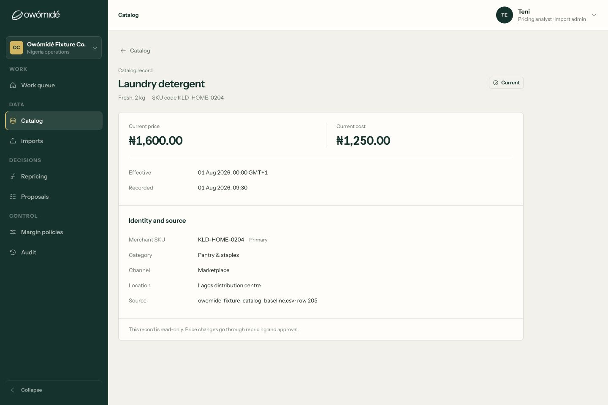
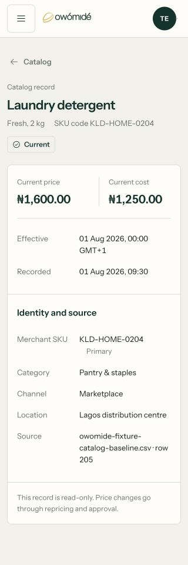
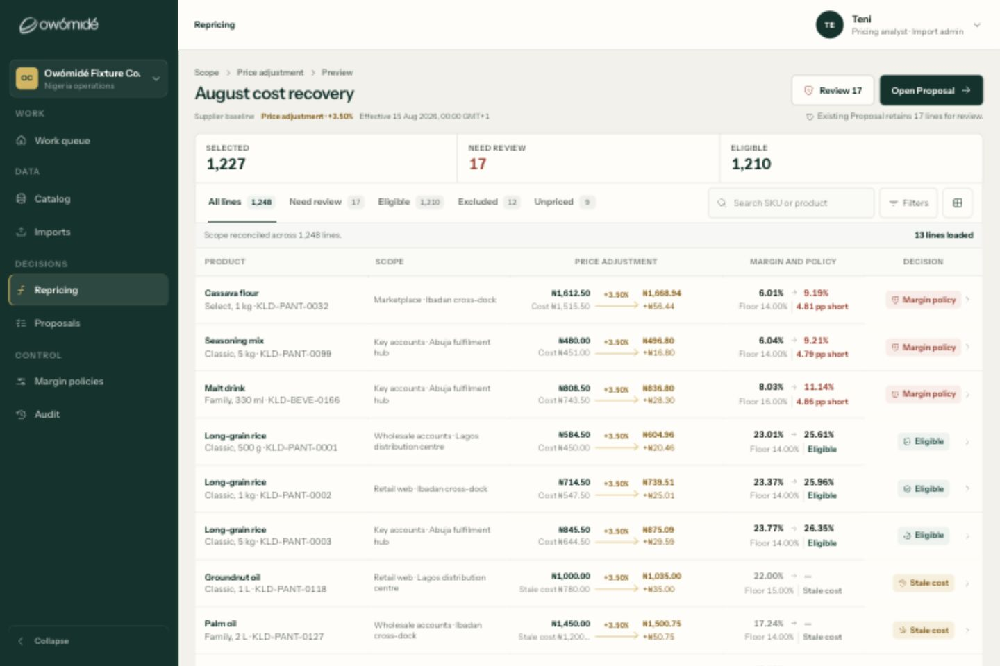
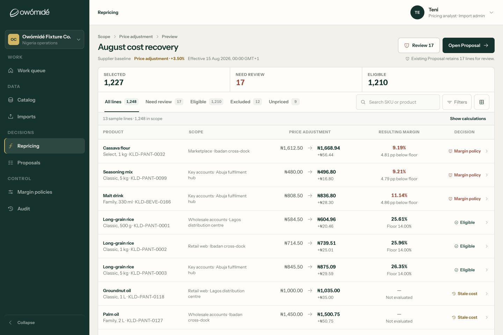
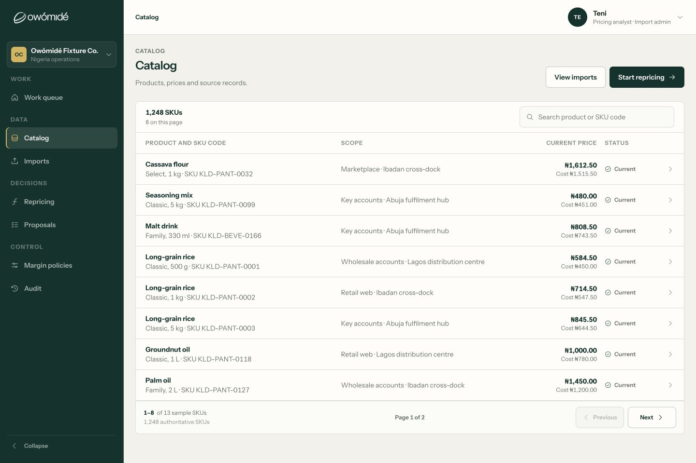
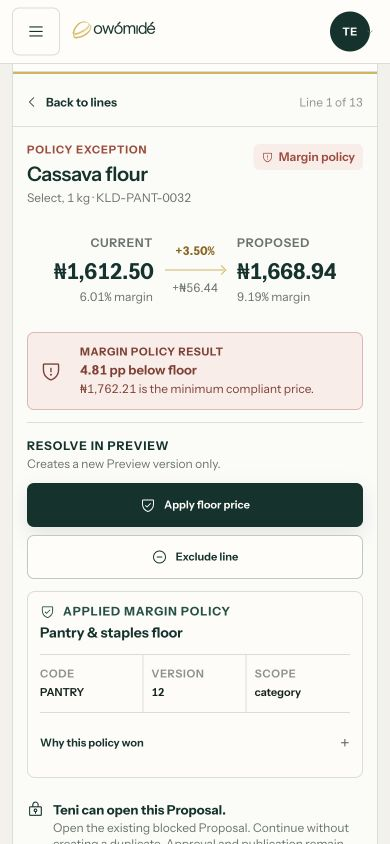

# Workspace craft review and implementation

Reviewed 7–8 September 2026 on the local `polish/workspace-premium-desk` worktree, based on `67218ab` plus the existing uncommitted polish. This pass preserves that work. Nothing was committed, pushed or deployed.

## Verdict

The previous pass moved in the right direction: operational titles, less decoration and persistent risk states. It did not yet establish a consistently composed workspace. Removing icons without rebuilding their layout produced the broken Catalog notice; repeated calculation evidence still competed with the decisions in Repricing.

The correction is information hierarchy, not more visual effects. The list is for finding and comparing; the inspector is for understanding and resolving; the full record is for complete evidence. Green/gold remain the brand, while semantic colour is concentrated on decisions and exceptions.

This is a completed, bounded craft pass on Catalog, Repricing and Work queue. It is **not a whole-product design sign-off or company-onboarding sign-off**.

## Changes made in this pass

1. **Catalog full record:** replaced oversized adjacent cards with a single bounded record sheet. Money has its own pair; effective/recorded dates are ordinary metadata, not oversized metrics. Complete identifiers and source text wrap. The read-only note is a plain full-width paragraph, without an abandoned icon column. Missing data remains unavailable rather than zero.
2. **Catalog scanning:** removed the repetitive Source column from list rows. SKU, scope, price/cost and status remain. Full provenance remains in the inspector and full record; this is progressive disclosure, not deleted evidence. Desktop and mobile have explicit compact-ledger grids, including protection against legacy docked selectors hiding Status.
3. **Repricing scanning:** default rows show current → proposed price, monetary change, resulting margin and decision. Repeated rule percentages, costs and before/after margin calculations move to an explicit Show calculations control. Exception reasons and unevaluated margins remain visible. Normal price changes no longer turn every row gold, and default status backgrounds are removed.
4. **Inspector:** made the current/change/proposed comparison more legible with balanced spacing. Restored Current cost/Stale cost as quiet evidence inside the inspector, so resolving a line never requires closing it just to recover cost. Policy evidence and permitted remediation remain available.
5. **Foundations:** extracted shared tokens and aligned operational title rules to one compact scale. Corrected the tablet/mobile focus treatment and margin/decision alignment. This is not a complete CSS consolidation.
6. **Queue correctness:** reasons wrap instead of truncating. Entry actions use effective capabilities; item navigation uses the exact authorised action target/version. Denied or malformed targets cannot fall back to a different record. Prepared-scope copy now acknowledges its fixed sample population.

The Product Design audit workflow shaped this pass: capture first, tie changes to visible failures, preserve the existing brand, then inspect the changed states at multiple widths. Independent agents reviewed typography, journey/role boundaries and backend readiness; a second read-only review caught missing inspector cost evidence before completion.

## Observed flow and screen health

These are the reviewed steps, not an assertion that every business journey was manually exercised.

| Step | Before / problem | Current result | Evidence and scope |
| --- | --- | --- | --- |
| 1. Work queue | Reason text could clip; navigation could infer a destination without honouring the exact action target. | Reasons readable; denied actions remain denied; exact target/version used. | Desktop screenshot; 14 focused queue BDD cases. Mobile queue was not recaptured in this pass. |
| 2. Catalog list | Repetitive source records consumed a full column; list and mobile cards carried too much supporting text. | Provenance is disclosed on open; list keeps identifying and pricing information. | Desktop 1440px and mobile 390px screenshots; source-recovery BDD. |
| 3. Catalog inspector → full record | User screenshot showed clipped date and word-per-line notice, with large unused card space. | Single readable sheet; complete dates and evidence; usable back action. | Desktop 1440px, tablet 768px and narrow mobile 320px. |
| 4. Repricing preview | Gold arrows, costs, rule, old/new margin, floor and coloured badges repeated on every row. | Decision-first default; calculations are explicitly expandable and reversible. | Desktop 1440px; mobile 390px; tablet 768px inspected during the pass. |
| 5. Select a line → inspector → return | Comparison type was too small; hiding table costs risked making cost inaccessible while the table is inert. | Readable comparison, cost evidence, policy result and remediation. Mobile selection brings the inspector below the fixed header; return restores the row. | Desktop 1440px, tablet 768px, mobile 390px; fixture interaction tests. |

### Catalog full record — after

### Repricing — before and after at 1440px

The after image shows the default reading hierarchy. Show calculations returns the underlying cost, repeated rule and old/new margin evidence; it does not recalculate prices or change authority.

### Catalog list and mobile inspector — after

Other accepted evidence includes `12-catalog-record-tablet-after.png`, `13-repricing-tablet-after.png` (tablet inspector), `15-repricing-mobile-list-after.png`, `17-catalog-mobile-after.png` and `18-work-desktop-after.png` in the same directory. Intermediate captures are retained for traceability: `07-repricing-calculations-after.png` predates the final detailed-money type increase; `14-repricing-tablet-list-after.png` predates the final tablet focus/alignment correction. They are not final-state sign-off images.

## What remains before the design feels complete

| Priority | Remaining work | Acceptance |
| --- | --- | --- |
| P1 | Apply the same scan → inspect → complete-record hierarchy to Import, Proposal review, Margin policy and Audit. | Fresh screenshots and interaction review for each route at desktop/tablet/mobile, including error and empty states; no decorative card/notice duplication. This pass did not manually recapture those flows. |
| P1 | Extreme-content testing. | Verify large monetary values (including eight-digit amounts), long SKU/organisation names, currencies, translations and 200% text zoom. Existing fixed composite widths/nowrap rules may clip sufficiently long amounts; sample-value screenshots are not proof that all real-company values fit. |
| P1 | Full accessibility review. | Real screen-reader and keyboard traversal, measured contrast, zoom/reflow, focus visibility, reduced motion and touch target audit. Keep cost/permission redaction in server DTOs. |
| P1 | Meaningful new-company empty states and next-owner handoffs. | An unseeded company can establish data, policy, approvers and a release destination, or see the responsible next action. Do not infer readiness from fixture success. |
| P2 | Consolidate composition CSS and split large route components. | One maintained table/inspector/notice pattern, component-owned styles, visual regression coverage. Extracted tokens are a start, not the end of cascade debt. |
| P2 | Audit sample-data consistency. | The inspected Laundry detergent record currently displays Pantry & staples as its category. The Work queue says “1,248 selected lines” while Preview distinguishes 1,248 in scope from 1,227 selected. Reconcile these with the fixture owner rather than silently changing governed source evidence in presentation code. |

The word “premium” should not hide these gaps. A restrained surface is useful only if the correct information, exact consequence and next responsible action are available without guesswork.

## Missing journeys and backend connection

See [Frontend journey gaps](FRONTEND_JOURNEY_GAPS.md) for role-by-role journeys and required negative BDD scenarios, and [Backend onboarding readiness](BACKEND_ONBOARDING_READINESS.md) for source links, owners, acceptance gates and delivery order.

Important findings:

- Analyst create/edit and submit are distinct concepts, but disabling submit alone strands drafts because the fixture submit rule currently requires the author. An authorised colleague needs a real versioned handoff/assignment path that retains original authorship.
- Contributor intake is a separate resource, not Proposal comments. Its receipt/search/evidence must not leak protected Proposal information or cost-rich Catalog fields.
- Renamed approval roles need verified legacy mappings and backend-assigned scope/stage. The CEO says rejection exists; it was not found in this checkout's exposed Proposal contract. Confirm the relevant branch before implementing an invented alternative.
- The live adapter is deliberately unreleased. Gateway/service identity propagation, complete repricing populations, immutable decision evidence, honest per-line publication outcomes and auditable reads are substantive connection gates.
- AI remains deferred; no Vendor Manager, FDE access or Workspace Admin is added.

## Verification record

Final checks used the bundled Node runtime meeting the package's Node ≥22 requirement and the existing installed dependencies:

| Check | Result |
| --- | --- |
| `npm run test:bdd` | 105 passed across 3 files |
| `npm run test:data` | 88 passed |
| `npm run test:hosting` | 8 passed |
| `npm run build` | Passed, Vite 6.4.2 |
| `git diff --check` | Passed |

The first BDD run caught the default unpriced row losing its explicit “No output” wording; this was fixed and the suite rerun. New coverage includes calculation expand/collapse, inspector cost recovery, Catalog complete evidence/missing data/source recovery, and queue capability/target-denial cases. Existing fixture import, proposal, approval, exception and publication scenarios also passed.

Limits: jsdom interaction tests do not measure rendered layout, exercise real browser accessibility technology or prove live multi-company enforcement. Browser evidence here is local fixture mode. No backend integration suite, deployed Cloudflare session, real company import, real invitation or external publication was tested. No remote deployment was changed.
