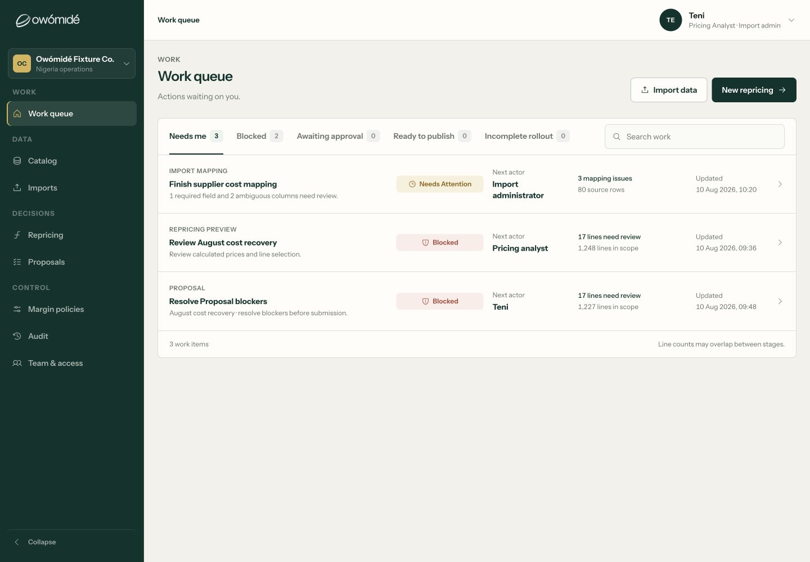
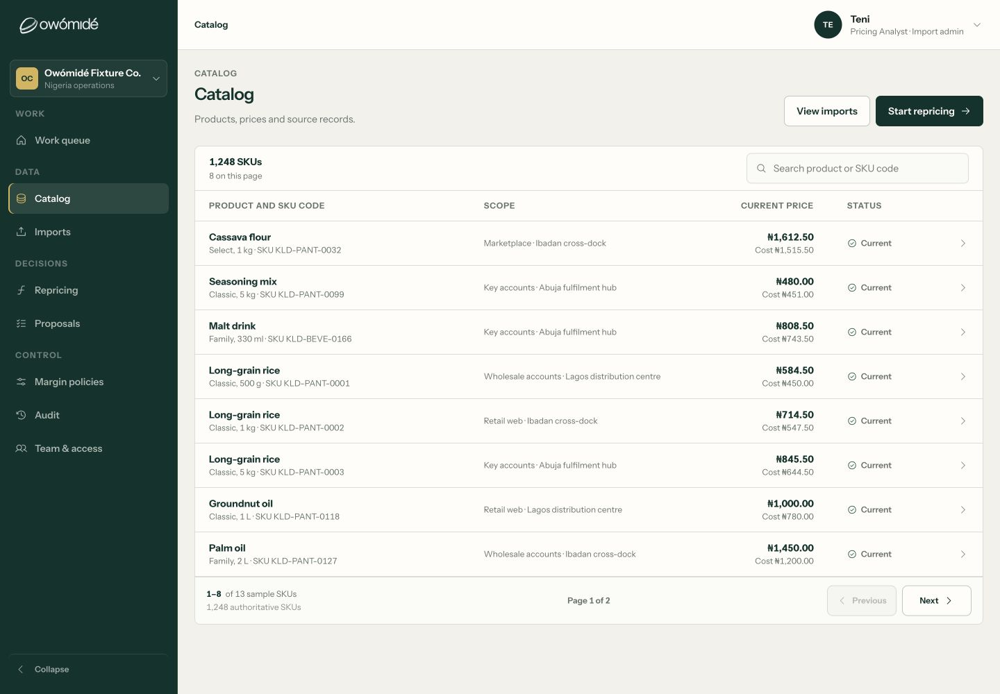
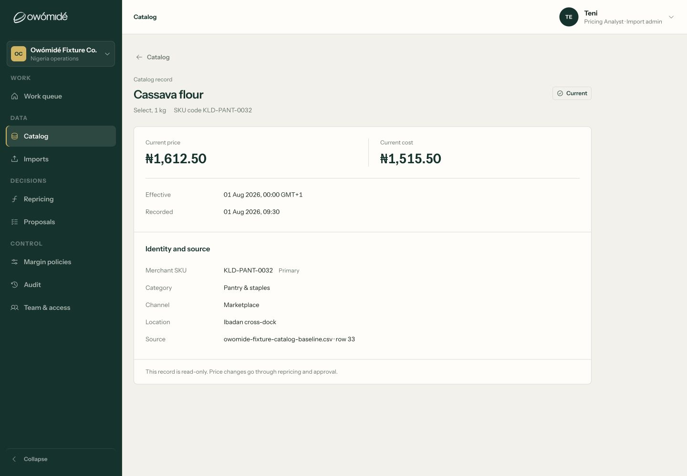
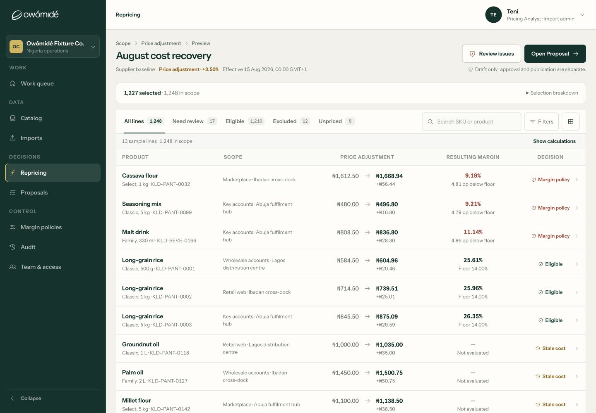
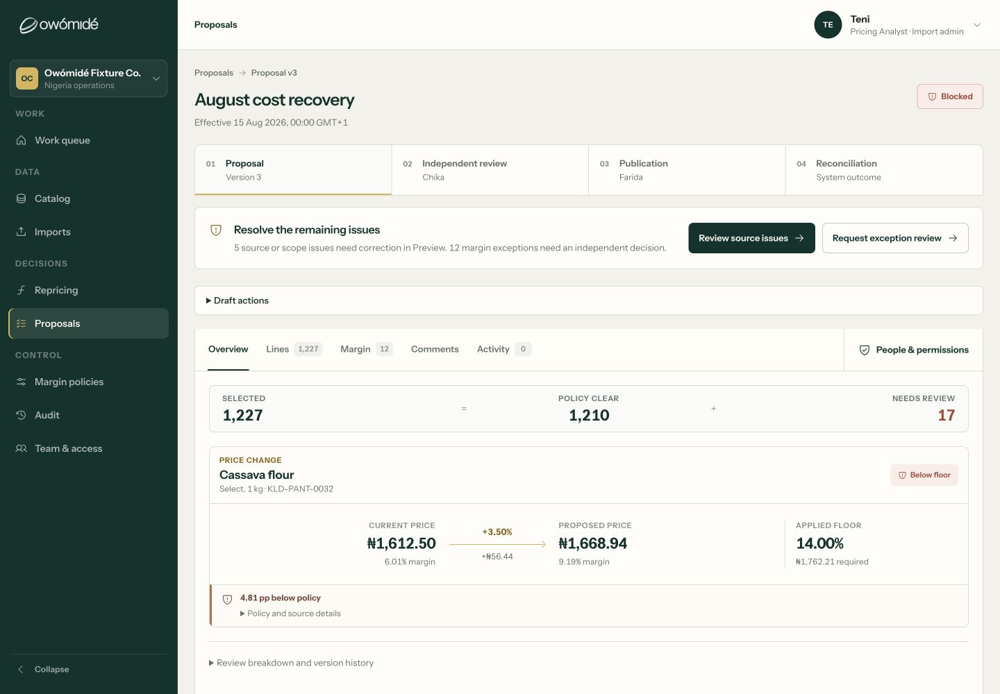
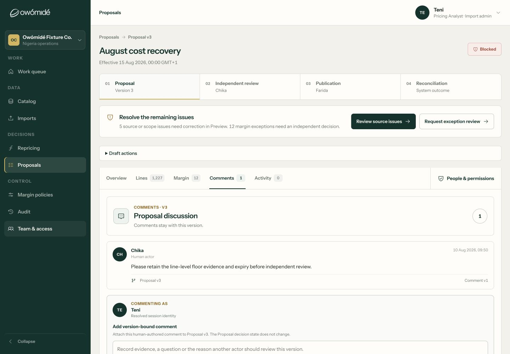
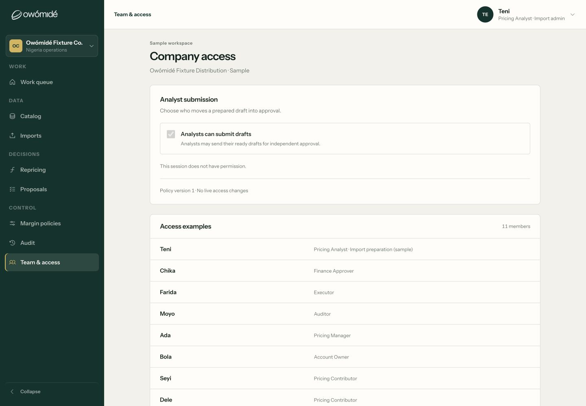
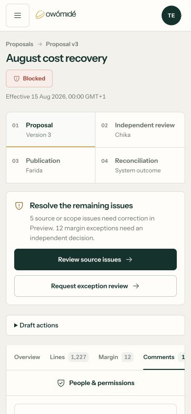

# Current workspace: captured journey review

12 September 2026. Eight accepted screenshots captured in this audit from the local fixture workspace using the Codex browser, saved and visually inspected. Desktop captures:1440×1000; mobile:390×844. These are current evidence, not the older screenshots supplied during prior polish work.

**Overall:** the captured desktop screens are calmer and more legible, but the product still communicates a narrow repricing/Proposal journey rather than the new PRD's full Initiative-to-outcome model. No “all screens premium” or complete accessibility claim is supported by this sample. The Product Design audit method shaped this review by requiring current screenshots, named step limits and distinction between visual evidence and source-backed capability.

## 1. Work queue — clear sample actions; incomplete lifecycle

Strengths: concise action-led rows, next actor, distinct work-item counts and separate line totals. The current viewport has no overlapping labels or numbers. Status colour is supported by text.

Risks: imports, Preview and Proposal all represent related work without an Initiative parent. Priority/deadline/monitoring responsibility is absent. Source review shows import/repricing responsibility inferred from capability, not actual assignment; screenshots alone cannot prove correct counting.

Accessibility follow-up: test row destination naming, keyboard order, focus after filter changes and small secondary text at zoom. No screen-reader compliance claim.

## 2. Catalog — calmer table; narrow entity/data journey

Strengths: restrained status treatment, sensible product/scope/price hierarchy and consistently aligned numbers. Pagination makes the sample population explicit:13 sample SKUs versus1,248 authoritative fixture SKUs. This is not proof that1,248 live rows were queried.

Risks: universal “Current” appearance does not show unresolved contextual candidates or cost basis. No manual Priceable Entity/economic-record management is represented here. Do not add every dimension to the default row; let the active context and inspectable detail explain it.

Accessibility follow-up: the list's button-row semantics need assistive-technology testing for header/value relationships; matching visual columns alone does not establish table semantics. Check long values and pagination at smaller widths.

## 3. Full Catalog record — visibly improved; applicability still under-explained

Strengths: price/cost occupy bounded columns; effective/recorded dates have their own rows; identity/source is readable. The previously shown narrow read-only sentence and overflowing date are **not reproduced in this captured state**.

Risks: “current cost” does not establish compatible Applicable Unit Cost or its selected basis. The sentence that all changes go through approval is too absolute if the new policy-authorised path is supported. Show the actual applicable route, not blanket approval language.

Accessibility follow-up: verify semantic label/value association, long external IDs/source names, zoom and protected-field variants. This single record is not proof for all data extremes.

## 4. Repricing Preview — less visual noise; not the complete analytical workspace

Strengths: small current-to-proposed transition, restrained colour, resulting margin instead of repeated calculation overload, optional “Show calculations” and collapsed selection breakdown. “Not evaluated” separates missing/stale cases from measured margin failures in the visible sample. No price-arrow collision is visible here.

Risks: the prepared +3.50% path is not arbitrary Builder construction or named Scenario comparison. The stage belongs inside an Initiative. “Eligible” must mean precisely what passed, not imply final decision or execution authority. Need all applicable Guardrails, not only a winning floor in detail.

Accessibility follow-up: verify sticky headers and horizontal overflow, row/inspector focus restoration and non-colour error identification. This audit did not replay the earlier inspector wheel/scroll regression; it remains a named targeted browser test, not declared re-fixed.

## 5. Proposal — next action is clearer; decision model needs correction

Strengths: source/scope issues versus margin exceptions are distinguished, there is one obvious next-step region, and expensive provenance detail is collapsible. Price transition and policy floor are contained in this viewport.

Risks: the four-step Proposal/Independent review/Publication/Reconciliation framing omits Initiative development, separate Review, actual implementation and monitoring. “Blocked” is a readiness fact, not the PRD's canonical Proposal decision status. Backend/frontend version mismatches require a model correction, not merely shorter labels.

Accessibility follow-up: check disclosure semantics, tab announcements, disabled reasons and outcome announcements. Only the current blocked version was captured; no live approval was performed.

## 6. Comments — attributable; too much repeated framing

Strengths: author, time and discussed Proposal version are visible; source comments and new composition are distinguished. The next-step controls remain available.

Risks: “Human actor”, “Resolved session identity”, “Comment v1” and repeated version explanations add administrative text to a simple discussion. The Proposal masthead, stepper, blocker card, Draft actions and tabs consume much of the first viewport before the discussion. Retain important provenance in accessible details rather than repeating it on every comment. Backend comments cannot yet store the exact version the UI promises.

Accessibility follow-up: ensure composer label/help association, submit feedback, time semantics and safe focus after adding a comment. No comment was added for this audit; the screenshot shows existing sample content.

## 7. Company access — honest sample policy; not onboarding

Strengths: sample mode is stated; Analyst submission is understandable; the current actor's disabled setting has a permission explanation. Role examples are shown without claiming live changes.

Risks: “Team & access” leads to examples and one toggle, not invitations, membership lifecycle, role/scope management, ownership or workflow administration. Its label promises more than the implemented sample offers to a real company. The replacement PRD's Admin role versus the earlier CEO omission needs a product decision.

Accessibility follow-up: test disabled-state announcement and authorised editable variants. This audit intentionally did not switch roles or mutate company permissions.

## 8. Mobile Proposal/comments — reflows; task content starts too low

Strengths: the title/status wrap cleanly, stepper becomes2×2 and next-step buttons stack with adequate visible hit areas. No horizontal price/label collision is visible in this captured top viewport.

Risks: the selected Comments tab's actual content starts below the first844px. Repeated context and blocked-state guidance dominate the task. The horizontal tab rail clips the far-right edge; verify discoverability/focus scrolling and consider compact context after a user enters a specific subtask. This is a task-effort issue even without a CSS overlap.

Accessibility follow-up: test mobile keyboard, zoom, touch scrolling inside an inspector, focus restoration, sticky boundaries and long translations/labels. One mobile state cannot establish all-screen responsiveness.

## Named limits and missing steps

| Step not captured end-to-end | Reason and treatment |
| --- | --- |
| Landing → login → workspace/logout | The local marketing preview was initially down. After restarting it, the existing browser error tab hit a browser URL-policy restriction. Capture was stopped; no blank/error screenshot is offered as accepted product evidence. Hosting tests and source review are separate, not a substitute live replay. |
| Real invitation/setup/membership | Not represented by the current sample login/access surfaces. Source benchmark records absence; no production identity flow exercised. |
| Arbitrary real upload/import commit | Reviewed in code/contracts, not executed against live data or a running service stack. |
| Initiative/Builder/Scenarios/pre-decision Review | Complete canonical journeys are absent in inspected source; no invented screenshots. |
| All approver/Contributor/Executor transitions | Sample tests/source examined, but no full multi-user browser replay in this run. |
| Manual implementation/monitoring/completion | Missing product/contract families; current publication is not an equivalent. |
| AI/in-product notifications/history search | Absent or stubbed runtime surfaces; no claim that a toast/audit fixture is their implementation. |
| All table/inspector/dropdown breakpoints | Current captures cover named states only. Existing unit/BDD checks help, but actual scroll/focus/zoom and data-extreme browser tests remain required. |

The skill-driven browser restriction stopped the entry-flow capture, not the source/requirements benchmark. No attempt was made to bypass it. The reviewed local frontend may differ from Cloudflare because working-tree changes are not yet a verified deployed build.

## UX direction for the next implementation

Preserve the restrained visual system and current improvements. Build a persistent Initiative header with purpose, current stage and next responsible person; put details in contextual tabs/drawers. Give each state one primary task and explain only its current blocker. Show calculations when they help a decision, not as repeated decoration. Distinguish “review”, “approve”, “authorise”, “implement” and “observe” in both copy and records.

Acceptance is not a subjective “premium” label: a user should identify what needs them, understand the few facts needed to act, complete it without layout/focus/scroll surprises, and trust that the resulting status is true. That requires both visual QA and the backend integrity gates in [the development plan](DEVELOPMENT_BACKLOG.md).
